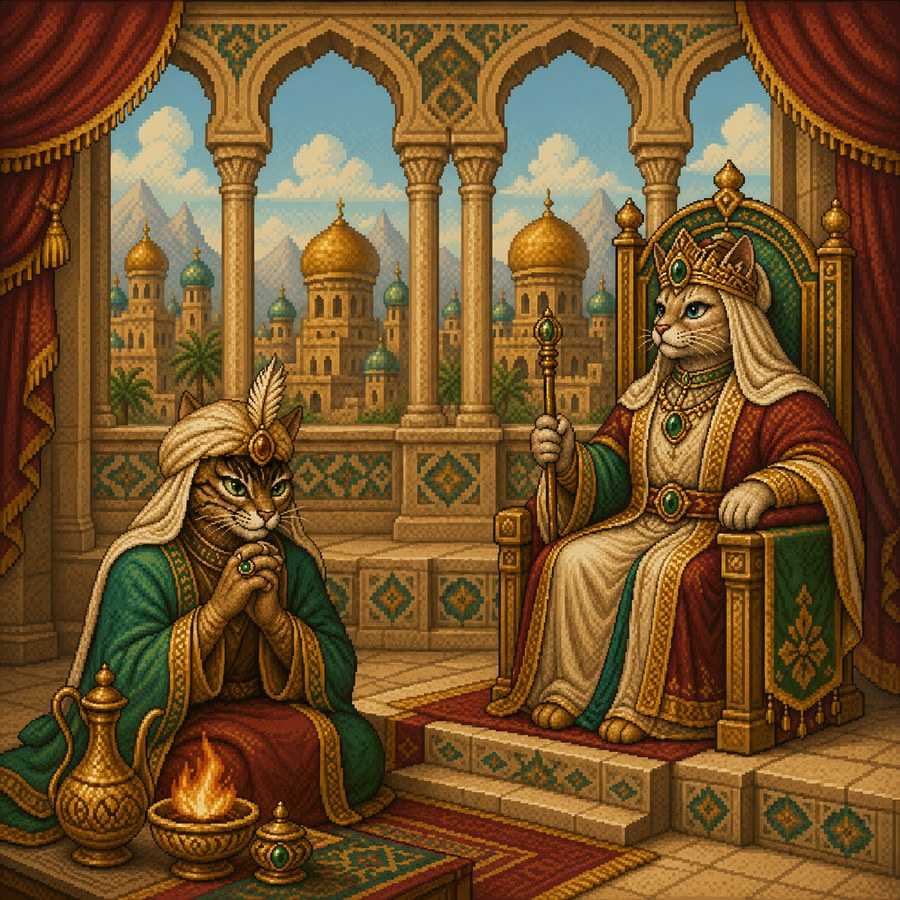

# Hazna

A sorting puzzle for Android, set in a padishah's treasury. Each kind of gem goes into its own sack, filled to the brim, drawstring pulled tight — and the sacks are cut to the count of the stones, so nothing fits by accident.

Every rule, every pixel of layout, every byte of logic was generated by AI (**Claude Opus 5**) through plain conversation. Not a single line was written by a human hand. No Android Studio, no Gradle: a hand-authored **smali** shell around a self-contained HTML game, assembled with `apktool` and signed with `uber-apk-signer`.

**Package:** `io.github.shumtugle.hazna` · **Version:** 1.1.0 · **Site:** [shumtugle.github.io/hazna](https://shumtugle.github.io/hazna/)



## The rules

- **Sacks are cut to the count** — as many places as there are stones of that kind. No slack, no crowding.
- **Like to like, then seal.** A full sack closes itself.
- **Two sets of rules.** Under **strict** rules (default) a seal is final: a sack closed on the wrong stones stays closed, and one careless move can cost the whole audit. Under **forgiving** rules a tap tears the seal off and puts the sack back to work. Switch in settings.
- **The chest cannot be sealed.** It takes in what has no place yet, and by the last knot it must stand empty.
- **Nothing finishes itself.** The final stone goes in by your hand — there is no auto-complete.
- Every **tenth** audit ends with a remark from the padishah, a hundred of them in rotation. Every **thirtieth**, a painting for five seconds.

## How it thinks

**Deals are unwound, not guessed.** A level is produced by taking a sealed treasury apart with reversible moves. Every step is invertible by construction, so a way back always exists — an unwinnable board cannot occur, and the generator needs no solver to vet itself. Generation costs about three milliseconds.

Under strict rules the way back must also avoid seals, so the generator refuses any reverse move that would leave a sack full and uniform: otherwise the forward path would have to reach into a sealed sack. Every deal is therefore beatable at the start under both sets of rules — only the player's own hand can ruin it.

**Hint and Solve** use a priority search with an estimate of the work remaining. Under forgiving rules a dominating rule applies: when a handful can be poured whole onto its own kind, only such moves are considered. Under strict rules that shortcut loses completeness — it can cut off the only path — so instead the search prunes traps: a move that seals a sack on less than the whole kind can never lead to a win. That prune is both sound and sharper, and the strict search runs about four times faster than the forgiving one.

**Dead ends are bisected.** A position with no way out stays that way after any move, so the history splits cleanly in two. The last salvageable point is found by bisection — six probes on a fifty-move game instead of fifty. Solve rewinds the stones to that fork and plays on from there.

**Sound is synthesised** at runtime through the Web Audio API. No audio files ship with the app.

**Progress** — audit number, chests sealed, moves in all — lives in `localStorage`. The board itself is never saved.

**Fourteen languages**, with right-to-left layout for Arabic, Hebrew and Urdu. The story is not a translation but the same tale told fourteen times. The padishah's hundred remarks exist in English and Russian; other languages hear him in English for now.

## Permissions

None. No internet, no location, no storage, no accounts, no ads, no analytics. The game runs fully offline.

## Structure

```
index.html            the project page (GitHub Pages)
play.html             the game itself, one self-contained file
cover.jpg amulet.png art/     shared assets, used by both the page and the APK
src/                  the game, split into readable pieces
├── shell.html          markup and styles
├── i18n_a.js i18n_b.js interface strings, 14 languages
├── desc.js             the story, 14 languages
├── doc.js              the about screen
├── padishah_ru.js      100 remarks, Russian
├── padishah_en.js      100 remarks, English
├── app.js              palette, language, saving, sound
├── engine.js           model, solver, level generator
├── ui.js               rendering, input, screens
└── build.sh            concatenates the above into play.html
app/                  the APK project for apktool
├── AndroidManifest.xml
├── apktool.yml
├── res/                launcher icons, app name
└── smali/io/github/shumtugle/hazna/
    ├── MainActivity.smali   the WebView shell
    └── Links.smali          sends http links to the browser
build-apk.sh          assemble, repack, sign
```

## Building

```sh
curl -L -o apktool.jar https://github.com/iBotPeaches/Apktool/releases/download/v2.11.1/apktool_2.11.1.jar
curl -L -o uber-apk-signer.jar https://github.com/patrickfav/uber-apk-signer/releases/download/v1.3.0/uber-apk-signer-1.3.0.jar

sh build-apk.sh
```

Before building, run the smoke test — it assembles the game, hands it a fake DOM and actually plays:

```sh
node tools/smoke.js
```

Two things that bite:

- `resources.arsc` must be **stored uncompressed** or Android 11+ refuses to install the package. apktool compresses it, so `build-apk.sh` repacks the archive by hand.
- `setDomStorageEnabled(true)` is required in the WebView; without it the progress silently fails to save.

## Playing without Android

`src/build.sh` produces `play.html`, a single self-contained file. Open it in any browser with `cover.jpg`, `amulet.png` and `art/` beside it — or just visit [the page](https://shumtugle.github.io/hazna/play.html).

## Credits

- Logic, code, text: [claude.ai](https://claude.ai) — Claude Opus 5
- Illustrations: [chatgpt.com](https://chatgpt.com)
- Built and signed by **Shumtugle**, Finland

---

**License:** MIT — see LICENSE.
